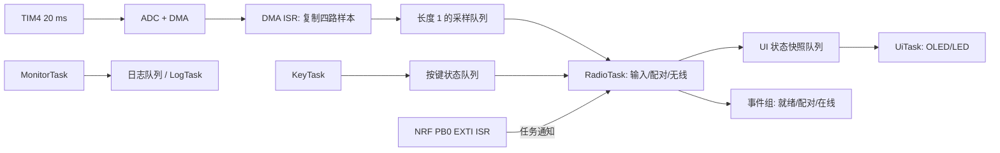

# Remote：一步步引入 FreeRTOS 的实战迁移指南

适用工程：`Project/remote.uvprojx`；初始源码核对日期：2026-10-29，最近更新：2026-10-30。第 0 关已完成源码修复及编译验证，其余阶段仍是迁移说明；固件尚未完成 RTOS 迁移或上板验证。文中路径均相对于 `Remote/`。

目标是用现有遥控器练习任务、调度、队列、信号量、互斥量、事件组、软件定时器、任务通知、内存、中断和 CPU 统计。每次只迁移一条链路，编译、下载、观察结果，再进入下一阶段。建议每个通过验收的阶段保存一次 Git 提交。

## 1. 当前工程到底处于什么状态

### 1.1 已经具备的条件

| 项目       | 从当前源码确认的事实                                                               |
| ---------- | ---------------------------------------------------------------------------------- |
| MCU        | Keil 目标为 STM32F103C8，Cortex-M3                                                 |
| 链接空间   | Flash 64 KiB，RAM 20 KiB，以工程配置为准                                           |
| 编译器     | ARMCC 5.06 update 6，`uAC6=0`                                                    |
| 时钟       | `Libraries/CMSIS/system_stm32f10x.c` 选择 72 MHz；实物晶振、实际时钟仍需上板确认 |
| 内核       | `FreeRTOS/include/task.h` 标明 V9.0.0                                            |
| 移植层     | 已加入 `FreeRTOS/port/RVDS/ARM_CM3/port.c`                                       |
| 内存管理   | 已加入 `FreeRTOS/port/MemMang/heap_4.c`                                          |
| 内核源文件 | Keil 中已经加入 tasks、queue、list、timers、event_groups、croutine                 |
| 配置       | 已有 `User/System/FreeRTOSConfig.h`，但多个学习功能尚未开启                      |
| 主程序     | 没有创建任务，没有调用 `vTaskStartScheduler()`，仍是裸机流程                     |

因此，第一步是把已有内核真正接入启动和中断链路，不必重新下载一份不同版本内核。先保持 V9.0.0 跑通，后续升级另开阶段。V9 没有通知数组、Stream Buffer、Message Buffer 等新版接口，不要直接套用新版教程。

当前真实路径为 `User/System`、`User/BSP`、`User/App`。原 `README.md` 中部分 `user/driver` 路径和函数名称已经过时；操作时以当前源码及本文路径为准。

### 1.2 现有执行链路

```text
main 初始化
  ├─ 主循环：WaitPairing → key_info → OledDisplayPairStatus
  └─ TIM4_CC4 每 20 ms 触发 ADC1 四通道扫描
       → DMA1_Channel1 搬运 ADC_value[4]
       → DMA1_Channel1_IRQHandler（在 User/App/sendpacket.c）
       → analyze_packet → data_exchange → NRF24L01_TxPacket
       → 等待 IRQ → 读取 ACK → 更新 LED
```

这里的实时问题不只是“没有任务”：DMA 中断里执行浮点换算、SPI、无线等待，配对主循环还会同时修改无线寄存器。迁移后要把中断缩短，并明确每份数据和每个外设由谁管理。

### 1.3 在迁移前建立裸机基线

1. 用当前 Keil 工程 Rebuild，保存错误、警告和 map 文件；若当前版本已不能运行，先修复下面的阻塞问题。
2. 下载后确认串口、LED、四路摇杆数值、配对和 OLED 的实际表现。
3. 测量或用 GPIO 标记记录 DMA 周期和中断执行时间。
4. 记录断开飞机、断开 NRF 模块后程序是否卡住。
5. 保存工程和配置快照，后续每阶段都与这份基线对照。

涉及无线联调时，拆除飞机桨叶或断开动力输出，尤其原有配对操作需要推高油门。

## 2. 第 0 关：先清理会掩盖 RTOS 问题的故障

以下表格保留第 0 关的原始问题和修复要求。2026-10-30 已完成对应源码修改及 Keil 编译检查；实施细节和上板验收见本节末尾。后续阶段仍是迁移计划，尚未实施。

| 文件/位置                                                   | 当前问题                                                                | 操作与预期                                                                                                                                       |
| ----------------------------------------------------------- | ----------------------------------------------------------------------- | ------------------------------------------------------------------------------------------------------------------------------------------------ |
| `User/BSP/nrf24l01/nrf24l01.c` 的 `NRF24L01_Read_Buf()` | `while(datalen>0)` 内没有递减 datalen，成功读取时会越界写入并无限循环 | 每成功处理一字节推进指针并递减剩余长度；检查空指针、错误出口和 CSN 释放；读 5 字节应准确结束                                                     |
| 同文件 `NRF24L01_TxPacket()`                              | `while(READ_NRF24L01_IRQ()!=0);` 无限等待                             | 改为有截止时间的等待；超时释放 CE/CSN，清理状态/FIFO，返回明确错误                                                                               |
| 同文件 `NRF24L01_Write_Buf()`                             | 空指针判断使用位与 `&`                                                | 改成 `(pBuf == NULL) && (datalen != 0U)`；避免混用位运算和逻辑运算                                                                             |
| `User/BSP/usart1/usart1.c`                                | 打开 RXNE 中断，但该文件没有接收 ISR 实现，当前系统中也未找到实现       | 最小启动阶段先关闭 RXNE 中断；需要命令行时再补接收 ISR                                                                                           |
| `User/BSP/adc/adc.c`                                      | ADC 使能在校准之后，复位校准后等待的也是校准状态                        | 按 STM32F1 标准库流程：使能 ADC、满足稳定时间、复位校准并等待 `ADC_GetResetCalibrationStatus()`、启动校准并等待 `ADC_GetCalibrationStatus()` |
| `User/App/sendpacket.c`                                   | `data_exchange()` 在 NOT 状态没有生成新帧                             | 明确未配对阶段使用的发现包策略，与飞机端确认；不要发送未初始化帧或残留帧                                                                         |
| 同文件 ACK 接收                                             | 固定读取 11 字节，没有先确认有效 RX 载荷，失败时状态可能过期            | 检查 RX_DR/FIFO、动态载荷宽度和读取返回值，再校验帧头尾；只有合法 ACK 刷新在线时间                                                               |

无线超时先给一个可配置的实验值，例如 15 ms，再结合 SETUP_RETR、空中时间及实测调整；它不是可靠性保证。驱动底层 SPI 的每个等待循环也必须有超时，否则外层超时无法生效。

**过关条件：** 无线模块不存在或飞机掉电时程序能返回错误，LED/串口仍可运行；读取函数不会超出调用者提供的缓冲区。未通过先排查驱动，不要把所有卡死归因于 RTOS。

### 第 0 关实施记录（2026-10-30）

已修改 Remote 固件，尚未启动 FreeRTOS 调度器：

- `NRF24L01_Read_Buf()` 按指定长度读取，每成功一字节推进指针和递减长度；读写接口拒绝非零长度的空指针，SPI 失败后释放 CSN。
- 发包前清理旧中断和收发 FIFO，检查 SPI 操作结果。等待 IRQ 默认限时 15 ms，超时返回 `NRF24L01_TIMEOUT (0xFE)`，通信错误返回 `NRF24L01_ERR (0xFF)`，达到硬件最大重试次数返回 `MAX_TX (0x10)`。成功发送返回 `TX_OK (0x20)`。
- 超时使用 DWT CYCCNT，避免当前 DMA ISR 阻塞 SysTick 导致截止时间不前进。NRF 初始化开启计数但不清零；无符号减法支持周期计数回绕。额外的一百万次轮询上限仅在计数器停用等异常时兜底，不代表这种异常下仍精确限时 15 ms。15 ms 指 IRQ 等待阶段，不含之前的 SPI 操作和之后的恢复开销；底层 SPI 的 TXE/RXNE 等待已有独立有界重试。
- 错误恢复时 CE 拉低、CSN 拉高，尝试清模块状态和收发 FIFO；模块物理断开时清理命令也可能失败，但每个 SPI 操作有界，不无限等待。修正 TX_Mode 写 SETUP_AW 缺少 W_REGISTER 命令位的问题。
- 启动时 NRF 自检最多尝试三次，失败打印诊断后继续初始化，不再永久停留在检测循环。模块缺失时仍会周期性发送并报告错误；**重新接入模块后建议复位**，目前未加入热插拔自动重配置。
- USART1 不启用未实现的 RXNE ISR，同时关闭对应 NVIC，保留现有轮询发送/读取接口；串口初始化不再修改系统中断分组。
- ADC 改成先使能、等待 1 ms 稳定、复位校准并检查复位状态、启动校准并检查校准状态。校准状态仍按硬件正常完成等待；本关未新增 ADC 故障恢复状态机。
- 每次组包先清零。NOT 状态发送固定全零的 11 字节探测载荷，故意不使用配对帧尾 `0x8B`。这是依据 `Drone/OBJ/pair_freq.c` 中仅检查帧尾的现有解析方式确定的：探测载荷可获得硬件 ACK，但不会触发飞机切地址。STEP1/DONE 的原有协议保持；硬件 ACK 不等于存在合法 ACK 载荷。
- 接收 ACK 前检查 RX_DR、RX FIFO 非空、动态载荷宽度必须为 11，以及每次 SPI 读取结果；长度错误或 SPI 读取失败丢弃 FIFO。通过帧头 `0xAA` 和帧尾 `0xAC` 检查后才发布数据并更新 `lastValidAckTick`。每次新事务/失败会清除旧在线标志，UI 另外在合法 ACK 超过 200 ms 未更新时清除在线状态；因此单次无合法 ACK 也会显示离线，这里尚未实现连续丢包容忍策略。
- 根据 `Drone/OBJ/parse_packet.c::NrfACKPacket()`，纠正 OLED 状态字段为 byte[1]（锁定）和 byte[2]（电量）；byte[3]/byte[4] 实际是电压值。飞机端源码无需更改。
- 新增可在调试器观察的 `g_radio_tx_ok`、`g_radio_tx_fail`、`g_radio_tx_timeout`、`g_radio_last_result`，不在 ISR 内打印日志。TX_OK 计数只表示硬件发送成功，不代表 ACK 应用载荷通过校验。

**软件验证：** 使用本机 Keil ARMCC 5.06 update 6 对 `Project/remote.uvprojx` 执行完整 Rebuild，结果为 0 错误、49 警告。警告来自未修改的 `FreeRTOSConfig.h` 打印式断言宏：内核源文件展开宏时未见 printf 声明；第 1 关将替换该断言实现。本关修改的业务/驱动文件没有编译警告。程序大小 Code=8960、RO-data=4292、RW-data=172、ZI-data=1804 字节；尚未链接进实际使用中的 RTOS 任务，不能据此推断最终 RTOS 内存预算。构建日志位于被忽略的 `Project/Objects/stage0-rebuild.log`。未连接硬件，编译通过不能替代下表验收。

| 上板实验       | 操作                                                       | 预期结果                                                                                              |
| -------------- | ---------------------------------------------------------- | ----------------------------------------------------------------------------------------------------- |
| 5 字节读取边界 | 读回地址到带前后哨兵字节的 5 字节数组，观察哨兵与 CSN      | 只写入 5 字节，哨兵不变，函数返回后 CSN 为高                                                          |
| 开机无 NRF     | 断电状态拆下模块再启动遥控器                               | 自检三次后打印缺失诊断；主循环继续，失败计数增加，无无限等待                                          |
| 飞机断电       | 模块正常、飞机掉电                                         | 常见返回 MAX_TX，失败计数增加；UI 显示离线，LED/主循环继续                                            |
| IRQ 永不拉低   | 使用测试固件/隔离连接令 MCU 始终读到 IRQ 高，保持 SPI 可用 | 返回 0xFE，超时计数增加；示波器测 IRQ 等待约 15 ms，CE 最终低、CSN 高；不要把外部电源直接短接模块输出 |
| 无效 ACK       | 测试端发送错误长度/错误头尾 ACK                            | 不更新 lastValidAckTick、不发布错误状态，不发生数组越界                                               |
| 默认发现与配对 | 上电先保持低油门，再执行高/低油门配对动作                  | NOT 阶段不因发现帧触发飞机配对；STEP1/DONE 按原流程切换；无新配对确认保证                             |
| 串口输入       | 向 USART1 发送字符                                         | 不进入未实现 ISR；诊断输出和主循环继续                                                                |
| 正常摇杆/状态  | 观察四路 ADC、合法 ACK 与显示                              | ADC 持续更新，锁定/低电状态对应飞机 ACK 的第 1/2 字节                                                 |

无线等待仍在 DMA ISR 中，配对主循环仍可能与它共享无线寄存器和状态；第 0 关没有解决完整并发架构。下一步按第 1～4 关启动内核并下放 ISR 业务，最终落实 RadioTask 的单一拥有者原则。

## 3. 先画出最终任务分工

以下频率、优先级和栈大小是练习起点，需要根据实测调整。任务优先级数字越大越高，和 NVIC 中断优先级的数字含义相反。

| 任务            | 起始优先级 | 触发方式                           | 起始栈深度（32 位 word） | 职责                                    |
| --------------- | ---------- | ---------------------------------- | ------------------------ | --------------------------------------- |
| RadioTask       | 4          | 等待 ADC 帧；无线阶段等待 IRQ 通知 | 384                      | 摇杆换算、配对状态机、组包、无线收发    |
| KeyTask         | 3          | `vTaskDelayUntil()`，10 ms       | 192                      | 按键消抖，发送稳定按键状态              |
| UiTask          | 2          | 100 ms 或状态变化                  | 384                      | 消费状态快照，独占 OLED 和 LED          |
| MonitorTask     | 1          | 1000 ms                            | 384                      | 堆、栈、丢帧、运行时间统计              |
| LogTask（可选） | 1          | 等待日志队列                       | 256                      | 独占串口发送，避免业务任务长时间 printf |
| Idle            | 0          | 内核自动运行                       | 128                      | 回收自删任务资源，后续观察 CPU 空闲     |
| Timer Service   | 2          | 软件定时器/命令队列                | 256                      | 仅执行短回调，启用定时器后自动创建      |

这些任务栈合计约 8 KiB（含可选日志和两个内核任务），还没有算 TCB、队列和分配开销。当前 RTOS 堆是 12 KiB，不要认为“所有功能一起开一定够用”。



核心规则：RadioTask 独占 NRF/SPI、`tx`、`pair`、ACK 解析；UiTask 独占 OLED/LED；KeyTask 生产按键状态。其他任务通过副本通信。`volatile` 不能保证一个结构体整体读写一致。

## 4. 第 1 关：检查工程接入并配置最小内核

### 4.1 Keil 检查步骤

1. 打开 `Project/remote.uvprojx`，先保持 ARM Compiler 5；RVDS 的汇编移植代码不能直接假定兼容 Compiler 6。
2. 确认编译 `tasks.c`、`queue.c`、`list.c`、`port.c` 和唯一一份 `heap_4.c`；后续使用事件组/定时器时编译对应源文件。`croutine.c` 可以保留，但本指南不使用协程。
3. 确认 Include Paths 包含 `../FreeRTOS/include`、`../FreeRTOS/port/RVDS/ARM_CM3`、`../User/System`。
4. 检查现有包含目录 `../User/BSP/iusart3` 的拼写；需要 usart3 时改成实际的 `../User/BSP/usart3`。
5. 确认启动文件为 `Libraries/CMSIS/startup/startup_stm32f10x_md.s`，目标 RAM/Flash 与实物相符。
6. 新建建议目录 `User/RTOS`，添加后续的 `app_rtos.c/.h`、`app_tasks.c/.h`、`app_hooks.c`，将源文件加入 Keil 分组，并加头文件搜索路径。

不要同时编译多个 heap 文件，也不要同时加入 ARM_CM0/CM4 等其他 port。

### 4.2 修改已有 FreeRTOSConfig.h

下面是需要替换或确认的宏，不是让你在文件尾重复追加同名定义。未列出的现有配置先保留。

```c
#define configCPU_CLOCK_HZ                       (SystemCoreClock)
#define configTICK_RATE_HZ                       ((TickType_t)1000)
#define configMAX_PRIORITIES                     8
#define configUSE_PREEMPTION                     1
#define configUSE_TIME_SLICING                   1
#define configMINIMAL_STACK_SIZE                ((unsigned short)128)
#define configTOTAL_HEAP_SIZE                    ((size_t)(12 * 1024))
#define configSUPPORT_DYNAMIC_ALLOCATION        1
#define configSUPPORT_STATIC_ALLOCATION         0
#define configUSE_16_BIT_TICKS                   0
#define configUSE_TASK_NOTIFICATIONS             1
#define configUSE_MUTEXES                       1
#define configUSE_RECURSIVE_MUTEXES              0
#define configUSE_COUNTING_SEMAPHORES            1
#define configUSE_TIMERS                        0 /* 第 8 关再开启 */
#define configUSE_MALLOC_FAILED_HOOK             1
#define configCHECK_FOR_STACK_OVERFLOW           2
#define configUSE_TRACE_FACILITY                 0 /* 第 11 关再开启 */
#define configUSE_STATS_FORMATTING_FUNCTIONS     0
#define configGENERATE_RUN_TIME_STATS            0
#define INCLUDE_uxTaskGetStackHighWaterMark       1
#define INCLUDE_xTaskGetSchedulerState           1
#define INCLUDE_vTaskDelay                       1
#define INCLUDE_vTaskDelayUntil                  1
#define INCLUDE_vTaskDelete                      1
#define INCLUDE_vTaskSuspend                     1
#define INCLUDE_vTaskPrioritySet                 1
#define INCLUDE_uxTaskPriorityGet                1
#define INCLUDE_eTaskGetState                    1
#define configPRIO_BITS                          4
#define configLIBRARY_LOWEST_INTERRUPT_PRIORITY  15
#define configLIBRARY_MAX_SYSCALL_INTERRUPT_PRIORITY 5
#define configKERNEL_INTERRUPT_PRIORITY \
    (configLIBRARY_LOWEST_INTERRUPT_PRIORITY << (8 - configPRIO_BITS))
#define configMAX_SYSCALL_INTERRUPT_PRIORITY \
    (configLIBRARY_MAX_SYSCALL_INTERRUPT_PRIORITY << (8 - configPRIO_BITS))
#define xPortPendSVHandler                       PendSV_Handler
#define vPortSVCHandler                          SVC_Handler
```

保留 `configUSE_TICKLESS_IDLE=0`、`configUSE_CO_ROUTINES=0`。先建立正常调度，再考虑低功耗。若减少 MAX_PRIORITIES，后面也要把 Timer Service 优先级改成有效范围内的数值。

现有 `configASSERT()` 只打印后继续执行，而且错误路径可能发生在中断或临界区。替换为停止并保留现场的实现。在配置头内声明普通类型接口，避免从配置头反向包含 task.h：

```c
void AppAssertFailed(const char *file, int line);
#define configASSERT(x) do { \
    if (!(x)) AppAssertFailed(__FILE__, __LINE__); \
} while (0)
```

在 `app_hooks.c` 中实现（可在调试器观察 file/line；不要在这里申请内存、拿互斥量或 printf）：

```c
#include "stm32f10x.h"
#include "FreeRTOS.h"
#include "task.h"

const char * volatile g_assert_file;
volatile int g_assert_line;

void AppAssertFailed(const char *file, int line)
{
    __disable_irq();
    g_assert_file = file;
    g_assert_line = line;
    for (;;) { }
}

void vApplicationMallocFailedHook(void)
{
    AppAssertFailed("malloc", 0);
}

void vApplicationStackOverflowHook(TaskHandle_t task, char *name)
{
    (void)task;
    (void)name;
    AppAssertFailed("stack overflow", 0);
}
```

栈溢出检测不是内存保护，发现问题时数据可能已经损坏。预防仍靠正确栈预算和水位测量。

## 5. 第 2 关：交接 SysTick、中断分组和延时

### 5.1 给 NVIC 一个统一配置入口

1. 系统早期调用一次 `NVIC_PriorityGroupConfig(NVIC_PriorityGroup_4)`，将四位有效优先级都用于抢占优先级。
2. 删除或替换 `User/System/nvic.c` 和 `User/BSP/usart1/usart1.c` 中的 Group_2 配置，避免串口初始化覆盖分组。
3. DMA1_Channel1 设抢占优先级 6、子优先级 0。
4. 后续 NRF 使用 EXTI0 时设优先级 6，USART1 接收 ISR 若调用 RTOS 设优先级 7，子优先级均为 0。
5. 在调试器确认实际分组和 NVIC 寄存器，不只检查源代码。

| NVIC 逻辑优先级 | 是否可调用 FreeRTOS FromISR API  |
| --------------- | -------------------------------- |
| 0～4            | 不可以；即便任务再紧急也不能破例 |
| 5～15           | 可以，但只能用 FromISR 版本      |
| SysTick/PendSV  | 由移植层设为最低优先级           |

标准库 `NVIC_Init()` 接收未移位的 6/7；不要把已移位的 `0x60/0x70` 填入抢占优先级字段。

### 5.2 第一阶段保留启动前的毫秒时基

当前 `SysTick_Handler()` 只递增 `g_system_tick_ms`，内核不会获得 tick。为了继续支持调度前的 `OLED_Init()` 等毫秒延时，可以暂时保留裸机 1 kHz SysTick，并在调度开始后转交内核。

在 `User/System/stm32f10x_it.c` 的唯一一个 SysTick_Handler 中使用：

```c
#include "FreeRTOS.h"
#include "task.h"
extern __IO uint32_t g_system_tick_ms;
extern void xPortSysTickHandler(void);

void SysTick_Handler(void)
{
    ++g_system_tick_ms;
    if (xTaskGetSchedulerState() != taskSCHEDULER_NOT_STARTED) {
        xPortSysTickHandler();
    }
}
```

这份兼容方案要求裸机和 RTOS tick 都是 1000 Hz，并且先不启用 tickless。调度器挂起时仍要向内核提交 tick，不能把条件写成只在 `taskSCHEDULER_RUNNING` 时调用。

保留现有 `xPortPendSVHandler → PendSV_Handler`、`vPortSVCHandler → SVC_Handler` 映射；当前 it.c 中这两个空函数已注释，继续保持。上面采用包装函数，所以**不要再定义** `xPortSysTickHandler → SysTick_Handler` 宏。否则会递归或产生重复符号。

启动前继续调用 `SysTick_init()`；调度器启动时由 port 设置 SysTick，之后禁止再次调用 `SysTick_init()` 或修改 LOAD。正式整理时可以把启动延时换成独立硬件时基，让 SysTick 完全由内核独占。

### 5.3 明确不同环境的延时方式

| 场景               | 方式                                       |
| ------------------ | ------------------------------------------ |
| 调度器启动前初始化 | 暂时保留 `Delay_ms()`                    |
| 普通任务等待毫秒   | `vTaskDelay(pdMS_TO_TICKS(ms))`          |
| 固定周期任务       | `vTaskDelayUntil()`                      |
| 微秒硬件时序       | DWT 或独立定时器计数；不使用任务延时       |
| ISR                | 只做短操作，禁止毫秒忙等，禁止任何阻塞调用 |

`key.c` 中的 5 ms 消抖忙等要改为按周期采样。`iic.c` 的初始化有 10 ms 延时，先放到调度器启动前；以后若移入任务，改为任务等待。

当前 `Delay_us()` 用 24 位掩码处理 SysTick 差值，但 SysTick 实际按 LOAD 重载，不等于按 2^24 回绕；跨重载时计算有问题，也硬编码了 72 MHz。迁移时换成 DWT 的 CYCCNT 无符号差值计时，或经确认空闲的硬件定时器；设定时钟后按 `SystemCoreClock` 换算，并测试跨回绕。微秒忙等会被高优先级任务/中断延长，要实测 CE 脉冲和软件 I2C。

**过关条件：** 头文件和 hooks 链接通过，没有多个 SVC/PendSV/SysTick 定义。若调度后延时不返回，先检查 SysTick 包装、优先级和中断是否被长期关闭。

## 6. 第 3 关：只启动两个任务，亲眼看调度

先不要启动 ADC、TIM4 和 DMA 中断，也不要运行旧主循环。main 先只保留系统时钟、分组、SysTick、LED 初始化。为了排除外设干扰，第一轮甚至不需要串口。

下面是可独立放进 `app_rtos.c` 的最小实验；`AppRtosStart()` 的声明放进 `app_rtos.h`，从 main 调用。main 中完成初始化后调用它，再留一个错误停机循环。

```c
#include "FreeRTOS.h"
#include "task.h"

volatile uint32_t g_fast_count;
volatile uint32_t g_slow_count;

static void FastTask(void *argument)
{
    TickType_t last = xTaskGetTickCount();
    (void)argument;
    for (;;) {
        ++g_fast_count;
        vTaskDelayUntil(&last, pdMS_TO_TICKS(10));
    }
}

static void SlowTask(void *argument)
{
    (void)argument;
    for (;;) {
        ++g_slow_count;
        vTaskDelay(pdMS_TO_TICKS(100));
    }
}

void AppRtosStart(void)
{
    BaseType_t result;
    result = xTaskCreate(FastTask, "fast", 128, NULL, 2, NULL);
    configASSERT(result == pdPASS);
    result = xTaskCreate(SlowTask, "slow", 128, NULL, 1, NULL);
    configASSERT(result == pdPASS);
    vTaskStartScheduler();
    /* 正常情况下不返回；常见原因是 Idle/Timer 任务内存不足。 */
    AppAssertFailed("scheduler returned", 0);
}
```

1. 在调试器观察两个计数，运行约 10 秒后停止，fast 与 slow 增量应接近 10:1。
2. 用 GPIO 在任务执行点打脉冲，观察 tick 量化和调度抖动。
3. 临时去掉高优先级 FastTask 的等待，观察 SlowTask 和 Idle 被饿死，再立即恢复。
4. 创建两个同优先级、会执行一段计算的实验任务，切换 `configUSE_TIME_SLICING`，观察时间片作用；相同优先级的永久忙循环不应进入正式业务。
5. 比较 `vTaskDelay()` 的“执行时间 + 延时”与 `vTaskDelayUntil()` 的固定基准周期；若工作超过周期，后者也无法凭空补足 CPU。

任务入口不能直接 return；一次性任务要 `vTaskDelete(NULL)`。本例栈深度 128 指 128 个 32 位 word，即 512 字节，并非 128 字节。

### 调度启动流程应该能讲清楚

```text
复位向量 → SystemInit/运行库 → main
→ 硬件初始化 → 创建通信对象 → 创建任务（进入 Ready）
→ vTaskStartScheduler → 创建 Idle（及启用后的 Timer Service）
→ port 配置优先级/SysTick → SVC 恢复第一个任务
→ SysTick 推进时钟，事件唤醒任务，PendSV 执行上下文切换
```

Cortex-M3 通常用 PSP 承载任务栈、MSP 承载异常处理栈。任务调用 Delay/队列等待后进入 Blocked，让出 CPU；Ready 代表可以运行，Suspended 代表被显式挂起。提高优先级不能让等待硬件的任务更快完成。

## 7. 第 4 关：DMA 中断下放业务，练习消息队列

**前置条件：** 两任务实验稳定，前置驱动问题修复，DMA 优先级已改为 6。

第一版直接让 RadioTask 等待 ADC 队列，在该任务中连续完成换算、配对、组包、发送。先不拆成多个高频任务，避免为了学习引入不必要的切换。

### 7.1 定义值类型消息

建议放入 `app_rtos.h`；各消息显式包含输入或状态，不让消费者直接读生产者全局变量。

```c
#include "FreeRTOS.h"
#include "queue.h"

typedef struct {
    uint16_t adc[4];
    TickType_t tick;
} AdcFrame;

typedef struct {
    uint8_t left;
    uint8_t right;
} KeyState;

typedef struct {
    uint8_t pair_step;
    uint8_t online;
    uint8_t unlocked;
    uint8_t low_battery;
    uint32_t tx_ok;
    uint32_t tx_fail;
} UiSnapshot;

extern QueueHandle_t g_adc_queue;
```

在启动调度器前创建 `g_adc_queue = xQueueCreate(1, sizeof(AdcFrame))` 并检查非 NULL。按键、UI 也各自创建长度为 1 的值拷贝队列。队列复制结构体本身；如果消息是指针，它只复制地址，不接管对象生命期。

### 7.2 替换原 DMA ISR，而不是再写一份

从 `User/App/sendpacket.c` 的 ISR 中移走换算、组包、无线和 LED 业务。可以将唯一 ISR 移到 it.c，但旧定义必须删除。

```c
#include "adc.h"
#include "app_rtos.h"

void DMA1_Channel1_IRQHandler(void)
{
    BaseType_t higher = pdFALSE;
    AdcFrame frame;
    unsigned int i;
    if (DMA_GetITStatus(DMA1_IT_TC1) != RESET) {
        DMA_ClearITPendingBit(DMA1_IT_TC1);
        for (i = 0; i < 4; ++i) {
            frame.adc[i] = ADC_value[i];
        }
        frame.tick = xTaskGetTickCountFromISR();
        xQueueOverwriteFromISR(g_adc_queue, &frame, &higher);
        portYIELD_FROM_ISR(higher);
    }
}
```

`xQueueOverwriteFromISR()` 只用于长度为 1 的队列。四通道在 DMA 完成后复制，不把 DMA 缓冲区地址传给任务，防止消费者读到后来覆盖的数据。此方案依赖 ISR 在下一轮 20 ms 采样开始前完成；RTOS 临界区不能停止 DMA。若长时间屏蔽中断仍可能产生混合帧，进阶时用更大循环缓冲区的半传输/全传输分区，并验证处理期限。

采样队列保留最新帧，过载时会覆盖旧帧，这是遥控输入的显式策略。若实验目标是“每帧都处理”，改用多元素队列和 `xQueueSendFromISR()`，并统计 pdFAIL；不能让 ISR 等待空间。使用序号或采样计数记录漏帧，不用队列长度推断总丢帧。

### 7.3 RadioTask 的每轮处理顺序

以下为迁移算法，`PublishUiSnapshot()` 等名称是待实现接口，不是仓库已有函数：

```text
阻塞接收 AdcFrame，超时阈值先设为 100 ms
  收到：检查样本年龄；消费最新按键状态
      → analyze_packet(frame.adc)
      → WaitPairing()
      → 按当前 pair 状态初始化并组包
      → 调用已有无线发送（必须先加超时）
      → 校验 ACK，更新最近合法 ACK 时间
      → 发布 UiSnapshot
  超时：记录采样故障并发布错误状态，不重复无限发送旧油门值
```

`sendpacket.h` 当前没有声明 `analyze_packet()` 和 `data_exchange()`，从新任务文件调用时要补充正确函数原型。主循环中的 `WaitPairing()`、`key_info()`、OLED 更新全部从原入口移除，防止多处并发执行。

启动顺序改成：初始化外设但不启动 TIM4 → 创建队列/任务 → 启动调度器 → RadioTask 首次执行时清 DMA 标志、打开 DMA NVIC、启动 TIM4。当前 `timing_trigger_init()` 内部就会 ENABLE TIM4，故应移到 RadioTask 启动段，或拆为 Init/Start 两个函数。不要让 ISR 在队列/句柄创建前调用 RTOS。

**过关条件：** DMA ISR 只做清标志、复制、唤醒；无线慢/掉线时系统仍可调度；正常采样约 50 Hz，RadioTask 等待时为 Blocked。故意让 RadioTask 延时 50 ms，能观察丢帧计数增加而不是积压过期控制帧。

## 8. 第 5 关：按键和 UI 任务，练习任务管理

### 8.1 KeyTask

1. 每 10 ms 用 `vTaskDelayUntil()` 读两路 GPIO。
2. 每个按键独立记录候选电平和连续稳定次数，例如连续 3 次相同才更新稳定值，形成约 30 ms 的实验消抖时间。
3. 将稳定按下状态映射成原协议的左 `0xE1`、右 `0xC8`；两个按键同时按下时分别保留状态。
4. 变化时覆写 KeyState 队列。RadioTask 在每帧处理前非阻塞接收最新值；没收到时保留上次稳定值。

这同时修正了原 `key_info()` 某些切换情况下另一键字段未及时清理的问题。状态队列适合持续按下；若扩展“每次按下都触发一次动作”，另用事件队列保存边沿，队列满时必须计数并定义策略。

### 8.2 UiTask

1. 从状态队列接收完整 UiSnapshot，在本地保存最近状态。
2. 最多每 100 ms 刷新，只有内容变化时清屏/重画。
3. 改写 `OledDisplayPairStatus()`、`DisplayPlaneInfo()`，让它们消费快照，不再直接读取 RadioTask 正在更新的 `pair`、静态 `rxPacket`。
4. LED 也统一在 UiTask 设置；移除 RadioTask 和 ISR 中的 LED 操作。
5. 实测一次整屏软件 I2C 刷新耗时。允许 RadioTask 抢占 UI，不要为了屏幕“流畅”全程关中断。

### 8.3 用可丢弃的实验任务练管理接口

创建一个额外计数任务，保存 TaskHandle_t，练习 `vTaskSuspend()`、`vTaskResume()`、`vTaskPrioritySet()`、`uxTaskPriorityGet()`、`eTaskGetState()`，结束时删除。观察 Running/Ready/Blocked/Suspended 的区别。

不要挂起持有互斥量的任务，不用 suspend/resume 当可靠事件通信：resume 发生得早会丢失唤醒。正式 RadioTask 用队列或通知等待。删除任务前要自行归还应用资源，内核不会自动释放它持有的互斥量或应用缓冲区；自删任务的 TCB/栈由 Idle 回收。

**过关条件：** OLED 刷新、长按/双键、无线丢包同时发生时采样链路仍按期运行；调试器能看到等待中的任务，而不是所有任务一直 Ready。

## 9. 第 6 关：信号量、互斥量，亲手观察优先级继承

### 9.1 二值信号量：先完成一次无线 IRQ 实验

在改用任务通知前，用二值信号量练习“中断完成 → 任务继续”：

1. 创建 `g_radio_done = xSemaphoreCreateBinary()` 并检查句柄；新创建时为空。
2. NRF IRQ 是 PB0，当前仅配为上拉输入。开启 AFIO 时钟，将 PB0 映射到 EXTI_Line0，配置下降沿并清 pending；在 NVIC 中启用 EXTI0、优先级 6。
3. 把 `NRF24L01_TxPacket()` 拆成“启动发送”和“读取结果/ACK/清硬件状态”。移除内部无限轮询。
4. EXTI0 ISR 只清 EXTI pending，调用 `xSemaphoreGiveFromISR()`，并根据 higher 执行 `portYIELD_FROM_ISR()`；不要在 ISR 读 SPI。
5. RadioTask 启动发送后 `xSemaphoreTake(g_radio_done, timeout)`。成功后读 STATUS 和 FIFO；超时后清硬件状态并恢复无线链路。

NRF IRQ 为低有效，清 EXTI pending 不会解除模块 IRQ。任务必须正确处理 TX_DS/MAX_RT/RX_DR 并清模块状态，确保 IRQ 回高。启动新发送前清旧状态、排空旧信号；发送完成可能早于 Take，这时信号量仍能保存这一次完成。二值信号量会合并多次 Give，不会累计每个边沿。

### 9.2 计数信号量：把“可用名额”做成实验

用 `xSemaphoreCreateCounting(4, 4)` 表示 4 个可用日志缓冲块。生产者 Take 一个名额后取空闲块，填数据并排队；LogTask 发完后把块索引放回空闲索引队列，再 Give。信号量只表示数量，具体块索引必须由队列/池管理，不能只减计数就假定知道是哪块。

故意让串口消费变慢，观察名额耗尽；生产者选择短超时或丢弃并计数，不拖住 RadioTask。完成练习后，若一个空闲队列已足够管理名额，可以移除重复的计数机制。

### 9.3 互斥量：保护完整日志输出

先用互斥量保护一整条 printf，而非保护单个字符：

```c
/* g_uart_mutex 在调度前由 xSemaphoreCreateMutex() 创建并检查。 */
if (xSemaphoreTake(g_uart_mutex, pdMS_TO_TICKS(5)) == pdTRUE) {
    printf("radio timeout\r\n");
    xSemaphoreGive(g_uart_mutex);
} else {
    /* 日志丢弃计数 +1，不影响实时控制。 */
}
```

这只串行化输出，还要避免不同任务同时使用不具备线程安全保证的 C 库状态。最终改成任务提交定长日志消息，由 LogTask 独占格式化/发送，更容易控制时延。不要在 ISR 或断言 hooks 中使用此互斥量。

在独立实验中：低优先级任务持锁后做有限计算，中优先级任务持续计算，高优先级任务请求该锁；比较用二值信号量作锁与真正 mutex 的差异。mutex 支持优先级继承，可缓解优先级反转，二值信号量不提供。实验结束恢复所有阻塞点，避免中优先级永久忙循环。

不要把整次无线等待或一整屏 OLED 刷新包进全局临界区。只有同一任务拥有的 mutex 才由它释放；mutex 不能在 ISR 使用。递归 mutex 仅在明确存在同任务嵌套获取需求时启用，并配套使用 Recursive API、成对释放；本项目初期重构调用层次即可。

**过关条件：** IRQ 先到、后到、不到三种情况均可结束一次发送；日志压力不会卡住控制链路；能说明信号量和互斥量用途差异。

## 10. 第 7 关：事件组表达系统状态

创建 `g_system_events = xEventGroupCreate()`，并检查创建结果。使用低位，例如：

```c
#define EVT_RADIO_READY  (1UL << 0)
#define EVT_PAIRED       (1UL << 1)
#define EVT_LINK_ONLINE  (1UL << 2)
#define EVT_ADC_FAULT    (1UL << 3)
```

1. RadioTask 初始化无线成功后 Set READY，恢复失败时 Clear READY。
2. 完成原有配对流程时 Set PAIRED；重新配对时 Clear。原代码 DONE 只说明本地切换完成，不等于收到了飞机确认，不要给它额外保证。
3. 收到合法 ACK 时更新最近 ACK 时刻并 Set ONLINE；超过实验阈值后 Clear。
4. MonitorTask 用 `xEventGroupWaitBits()` 等待 `READY | PAIRED`，`clearOnExit=pdFALSE`、`waitForAll=pdTRUE`；用返回值与掩码比较，区分成功与超时。

事件组适合“状态是否成立”，不适合保存每一个按键边沿，也不适合传输 ADC 数据。V9、32 位 tick 下用户可用位为低 24 位，最高 8 位保留；本例只用四位。

`xEventGroupSetBitsFromISR()` 会把处理延后到 Timer Service，依赖软件定时器和 `INCLUDE_xTimerPendFunctionCall=1`，并可能因为命令队列满而失败。这里直接让 ISR 唤醒 RadioTask，由任务更新事件组，降低中断复杂度。

**过关条件：** 关飞机后 ONLINE 清除，重新收到合法 ACK 才恢复；PAIRED 与 ONLINE 的生命周期能分别解释。状态事件不要设置成读取后自动清除，避免多个观察者互相干扰。

## 11. 第 8 关：软件定时器做维护动作

先保证前面的任务稳定，再替换配置：

```c
#define configUSE_TIMERS               1
#define configTIMER_TASK_PRIORITY      2
#define configTIMER_QUEUE_LENGTH       10
#define configTIMER_TASK_STACK_DEPTH   256
```

1. 用 `xTimerCreate()` 创建 1000 ms 自动重装定时器，检查非 NULL。
2. 回调只给 MonitorTask 发通知或向维护队列投递轻量消息，发送等待时间为 0。
3. 调用 `xTimerStart()` 并检查 pdPASS。pdPASS 表示命令成功入队，不表示回调已经执行。
4. 再创建一次性“配对提示超时”定时器；触发后只发送提示事件，RadioTask 决定是否转状态，避免回调直接改无线寄存器。
5. 练习 Stop、Reset、ChangePeriod，分别观察一次性和自动重装的行为。

所有回调在同一个 Timer Service 任务中执行，不能 Delay、长时间 printf、刷 OLED 或阻塞等待队列/锁。回调太慢会拖延其他定时器和内核延后事件处理。

连接超时建议由 RadioTask 根据 `now - last_valid_ack` 的无符号 tick 差判断，例如先实验 200 ms。不要每个包都 Reset 一个软件定时器造成大量命令；20 ms ADC 触发继续由 TIM4 完成，软件定时器不替代精确硬件采样。

**过关条件：** 定时事件可停止/恢复；故意放慢维护处理后，定时器回调仍短小；Timer Service 的内存分配和栈水位也纳入检查。

## 12. 第 9 关：任务通知替换单接收者的信号量

现在把第 6 关 NRF 完成信号量替换为任务通知，比较 RAM 和代码复杂度。保留 ADC 队列：队列携带样本，通知只负责唤醒。

```c
/* EXTI0_IRQHandler 片段；需包含 FreeRTOS.h、task.h 和外设头文件。
 * g_radio_task 必须在启用中断前已创建成功。 */
BaseType_t higher = pdFALSE;
if (EXTI_GetITStatus(EXTI_Line0) != RESET) {
    EXTI_ClearITPendingBit(EXTI_Line0);
    vTaskNotifyGiveFromISR(g_radio_task, &higher);
    portYIELD_FROM_ISR(higher);
}
```

RadioTask 的发送过程如下：

```text
结束上一事务并清硬件旧状态，确保 IRQ 回高
→ 非阻塞清除旧通知计数 ulTaskNotifyTake(pdTRUE, 0)
→ 启动新事务
→ ulTaskNotifyTake(pdTRUE, timeout)
→ 若为 0，执行超时恢复；否则读取 STATUS 验证真实结果
```

“清旧通知”必须发生在启动发送之前；启动后再清可能吃掉本次已经到达的完成事件。完成通知不是 TX 成功证明：MAX_RT、RX_DR 等也能使 IRQ 变低，必须读硬件状态。

`pdTRUE` 返回后清整个通知计数；`pdFALSE` 每次减 1，可用于计数事件。通知不传递大结构体，只携带一个 32 位值/计数；V9 每任务只有一个通知槽，不要把 ADC 完成、无线 IRQ、维护命令都混用同一计数。如果使用 `eSetBits` 多事件，需要统一采用 `xTaskNotifyWait()` 的位协议，不与计数式 Take 混用。

若以后改成异步状态机、允许多个未完成无线事务，还要引入事务序号和明确的迟到 IRQ 处理，不能靠一个通知数区分所有事务。

**过关条件：** 抢在任务开始等待前发生 IRQ 也能被接收；连续超时和恢复后没有旧通知让下一次发送“瞬间成功”。

## 13. 第 10 关：内存管理和静态对象

### 13.1 先测量，再调整

在 MonitorTask 每秒记录：

```c
size_t free_now = xPortGetFreeHeapSize();
size_t free_min = xPortGetMinimumEverFreeHeapSize();
UBaseType_t radio_words = uxTaskGetStackHighWaterMark(g_radio_task);
```

水位是历史最小剩余栈，单位为 word，乘 `sizeof(StackType_t)` 转字节。分别覆盖配对、正常发送、断线、屏幕整刷、日志突发和错误恢复；只测空闲页面没有意义。

RAM 预算按下面关系核算 map：

```text
20 KiB = 全局/静态数据（其中含 heap_4 的 12 KiB 数组）
       + 启动文件中的 MSP 栈/运行库堆 + 其他链接区 + 余量

12 KiB RTOS 堆内部 = 动态任务栈 + TCB + 队列/信号量/事件/定时器
                 + 分配开销 + 空闲余量
```

不要把动态任务栈在 20 KiB 总账中重复计算；也不要把静态任务栈误算进 RTOS 动态堆。用 map 分别确认启动文件的 Stack_Size、Heap_Size；C 库 malloc 堆与 `pvPortMalloc()` 的 heap_4 并不是同一个分配器。

heap_4 支持释放和相邻空闲块合并，但仍可能有碎片；总空闲不等于最大可分配连续块。V9 本地接口已有 GetFreeHeapSize 和 GetMinimumEverFreeHeapSize，不要直接使用新版 `vPortGetHeapStats()`。

### 13.2 动态转静态练习

1. 开启 `configSUPPORT_STATIC_ALLOCATION=1`，先保留动态分配用于对照。
2. 用 `StaticTask_t` 和 `StackType_t[]` 为 KeyTask 提供固定存储，改用 `xTaskCreateStatic()`。
3. 用 `StaticQueue_t` 和消息存储数组改造一个长度 1 的队列，调用 `xQueueCreateStatic()`；缓冲区大小为队列长度乘消息大小。
4. 所有这些存储使用文件作用域 static，不能放在创建函数的局部自动数组里。
5. 实现内核必需的 `vApplicationGetIdleTaskMemory()`；已开启 timers 时还要实现 `vApplicationGetTimerTaskMemory()`，具体签名与本地 `tasks.c`、`timers.c` 声明一致。
6. 观察自由堆变化，同时查看 map：静态化使内存归属更清晰，但不意味着总 RAM 自动减少。

Idle 静态内存回调示例；Timer 回调同样返回独立 TCB、栈数组和 `configTIMER_TASK_STACK_DEPTH`：

```c
void vApplicationGetIdleTaskMemory(StaticTask_t **tcb,
                                   StackType_t **stack,
                                   uint32_t *depth)
{
    static StaticTask_t idle_tcb;
    static StackType_t idle_stack[configMINIMAL_STACK_SIZE];
    *tcb = &idle_tcb;
    *stack = idle_stack;
    *depth = configMINIMAL_STACK_SIZE;
}
```

每个创建 API 都要检查失败；不要把带副作用的创建调用直接塞进将来可能被关闭的断言宏。练习在单独任务中申请、释放不同大小块，观察最低空闲记录；不在 ISR 分配，也不每 20 ms 创建/删除任务。若使用池，明确分配、排队、消费和归还的所有权。

**过关条件：** 所有任务都有压力场景水位记录，所有对象有失败处理，长时间循环运行没有持续内存减少。栈安全余量应根据最坏路径测量决定，而非套固定百分比。

## 14. 第 11 关：中断、临界区和 CPU 使用率

### 14.1 区分三种保护方式

| 方式                                         | 保护范围与限制                                                                               |
| -------------------------------------------- | -------------------------------------------------------------------------------------------- |
| mutex                                        | 任务间共享资源，可阻塞并提供优先级继承；ISR 不可用                                           |
| `taskENTER_CRITICAL()` / EXIT              | CM3 port 使用 BASEPRI 屏蔽一部分中断；极短、不阻塞，不会停止 DMA，也不屏蔽 0～4 高紧急度 ISR |
| `vTaskSuspendAll()` / `xTaskResumeAll()` | 暂停任务调度，中断仍可运行；不是保护任务与 ISR 共享变量的锁                                  |

ISR 内如确实需要保护，使用本移植层的 ISR 中断屏蔽/恢复接口，保存并恢复原屏蔽状态；不要从 ISR 调用普通任务临界区和等待函数。

给 DMA ISR 入口/出口各翻转一次空闲 GPIO，用逻辑分析仪同时测 ADC 节拍和无线发送时间。检查最坏路径，不只看平均值；临时关闭日志/OLED 对比，定位干扰来源。

### 14.2 开启任务运行时间统计

现有 FreeRTOSConfig.h 把 `configUSE_TRACE_FACILITY==1` 与 `trcRecorder.h` 绑定。仓库未见完整 recorder 依赖，开启内核统计前先移除这段强制包含，或改成独立的 `APP_USE_TRACEALYZER` 开关。内核 trace facility 本身不要求安装 Tracealyzer。

```c
#define configUSE_TRACE_FACILITY             1
#define configGENERATE_RUN_TIME_STATS        1
#define configUSE_STATS_FORMATTING_FUNCTIONS 0

void AppRunTimeTimerInit(void);
unsigned long AppRunTimeCounter(void);
#define portCONFIGURE_TIMER_FOR_RUN_TIME_STATS() AppRunTimeTimerInit()
#define portGET_RUN_TIME_COUNTER_VALUE()         AppRunTimeCounter()
```

`AppRunTimeTimerInit/Counter` 是需要新增的接口，不是现有函数。推荐第一版选一个确认未被占用的 TIM2，以 10 kHz 更新中断递增 32 位计数器：

1. 核对实际 APB1 定时器时钟。若为 72 MHz，可用 PSC=71、ARR=99 形成 10 kHz；APB 分频和定时器倍频规则必须与实测一致。
2. TIM2 ISR 清更新标志并递增计数，不调用 RTOS；根据中断预算选优先级并实测开销。普通 16 位 TIM2 CNT 不能直接当长期 32 位统计时钟。
3. 10 kHz 比 1 kHz tick 快 10 倍；32 位计数约 119 小时回绕。先在不跨总计数回绕的短时实验里验证，长时间测量要设计回绕/扩展处理。
4. 统计时基不能在任务切换时清零。DWT 虽方便，但 72 MHz 的 32 位周期计数约 59.7 秒回绕，直接使用会让长时间统计出错。

MonitorTask 用 `uxTaskGetSystemState()` 把状态写入预分配的 `TaskStatus_t[]`，容量包含所有用户任务、Idle 和 Timer Service，并预留扩展。返回 0 时检查容量，不能输出旧数据。采集会短暂暂停调度，限制频率，不在 ISR 调用。

对相邻两次采样计算：

```text
任务占比 = 100 × Δ任务运行计数 / Δ总运行计数
CPU 忙碌率近似 = 100% - Idle 的区间占比
```

用至少 64 位中间值计算 `100 × 差值`，避免乘法溢出；任务句柄变化、任务删除重建时重建基线。总计数差为 0 时跳过计算。

该统计通常会把 ISR 时间记到当时被打断的任务，Idle 占比只是近似负载，不等于精确业务 CPU 时间。10 kHz 统计 ISR 自身也有成本，需要与 GPIO 测量交叉验证。少打印日志、固定采样窗口，避免测量动作显著改变结果。

`vTaskList()`、`vTaskGetRunTimeStats()` 可作短期演示，但依赖格式化并由调用者保证输出缓冲区足够大；本项目优先用原始结构体统计后输出有界结果。

**过关条件：** 增加有限计算负载时对应任务占比上升，Idle 下降；无线失联后任务阻塞而非永久忙等；能同时报告周期、最坏延迟、丢帧和负载。

## 15. 最终文件改动地图

下表描述最终迁移目标；第 0 关涉及的驱动修复已经实施，其余部分按各阶段推进。

| 文件                                      | 迁移后职责/改动                                    |
| ----------------------------------------- | -------------------------------------------------- |
| `User/System/main.c`                    | 初始化基础硬件、创建对象/任务、启动调度器          |
| `User/System/FreeRTOSConfig.h`          | 分阶段开启功能、断言、内存和中断约束               |
| `User/System/stm32f10x_it.c`            | 唯一 SysTick 包装；可集中 DMA/EXTI ISR             |
| `User/System/systick.c`                 | 启动前延时；移除任务中的毫秒忙等依赖，修复微秒时基 |
| `User/System/nvic.c`                    | Group_4，统一 ISR 优先级规划                       |
| `User/BSP/usart1/usart1.c`              | 移除 Group_2，关闭未实现的 RXNE 或补接收 ISR       |
| `User/BSP/adc/adc.c`                    | 校准顺序检查，DMA 只负责采样搬运                   |
| `User/BSP/tim/timing_trigger.c`         | 把 TIM4 配置和启动分开，避免过早触发               |
| `User/BSP/nrf24l01/nrf24l01.c`          | 修读取循环，所有等待有界，拆分发送/完成处理        |
| `User/App/sendpacket.c/.h`              | 拆 ISR 与业务，明确组包/ACK接口，UI 使用快照       |
| `User/App/pair_freq.c`                  | RadioTask 单一调用者，配对状态和无线修改顺序明确   |
| `User/BSP/key/key.c`                    | 改成周期消抖，生成独立稳定键状态                   |
| `User/RTOS/app_rtos.c/.h`（新增）       | 通信对象和句柄创建、任务启动、消息类型             |
| `User/RTOS/app_tasks.c/.h`（新增）      | 各任务实现，可在稳定后分文件                       |
| `User/RTOS/app_hooks.c`（新增）         | 断言、malloc失败、栈溢出、可选静态内存回调         |
| `User/RTOS/app_runtime.c`（新增，可选） | 独立统计时基和计数接口                             |
| `Project/remote.uvprojx`                | 新文件、搜索路径、工具链和内存边界                 |

## 16. 和你教材目录逐项对应

| 教材主题          | 本项目练习                      | 完成时应能解释                          |
| ----------------- | ------------------------------- | --------------------------------------- |
| 创建任务          | 第 3 关两个计数任务、最终任务表 | 入口、栈单位、参数生命期、创建失败      |
| FreeRTOS 启动流程 | 第 2～3 关 SysTick/SVC/PendSV   | 从 main 到第一个任务，tick 如何驱动等待 |
| 任务管理          | 第 5 关临时任务                 | 状态、优先级、挂起/恢复、删除和 Idle    |
| 消息队列          | ADC/Key/UI 值消息               | 值拷贝、阻塞、满队列、最新帧策略        |
| 信号量            | NRF IRQ、日志缓冲池实验         | 同步、计数、事件合并、资源索引          |
| 互斥量            | 日志输出和三任务反转实验        | 所有权、继承、锁粒度、死锁              |
| 事件              | 系统事件组                      | 状态位、AND/OR等待、超时和清位          |
| 软件定时器        | 心跳与配对提示                  | 命令队列、服务任务、短回调              |
| 任务通知          | NRF 信号量替换                  | 单接收者、计数/位模式、早到通知         |
| 内存管理          | heap_4、水位、静态化            | 堆和栈、RAM总账、碎片和生命周期         |
| 中断管理          | DMA/EXTI 下放、Group_4          | FromISR、优先级阈值、临界区边界         |
| CPU 使用率统计    | 第 11 关                        | 独立时基、区间差值、回绕和测量成本      |

“尽可能用到”可以通过前后替换和专项实验做到。最终工程按真实需求保留机制：同一个 IRQ 不需要同时 Give 信号量和发通知，同一个缓冲池也不必同时用两套名额管理。保留实验分支和记录，比把所有 API 塞进生产链路更方便复习。

## 17. 常见故障排查

| 现象                          | 优先检查                          | 下一步                                    |
| ----------------------------- | --------------------------------- | ----------------------------------------- |
| 找不到 FreeRTOS.h/portmacro.h | Include Paths                     | 检查路径相对于 Project 的层级及 ARM_CM3   |
| SVC/PendSV/SysTick 重复符号   | it.c 空实现和配置宏               | 一个向量只保留一个有效入口                |
| 编译 port.c 的汇编失败        | 编译器是否切到 AC6                | 恢复 ARMCC5，或另行规划匹配工具链的移植层 |
| 无法链接 trcRecorder.h        | trace facility 附带的强制 include | 分离内核 trace 与外部录制器开关           |
| 一调度就 HardFault            | 栈、向量、port、时钟              | 用最小两任务复现，查看 PC/LR 和 CFSR/HFSR |
| Delay 后不再运行              | SysTick 没交给内核、IRQ被屏蔽     | 检查 tick 是否递增、BASEPRI/PRIMASK       |
| FromISR 命中断言              | 中断分组或优先级错误              | 查串口初始化是否又设 Group_2              |
| 调度器返回或后续创建失败      | 堆不足、内核任务分配失败          | 看 hooks、map 和最低空闲堆                |
| 收到串口字符后卡死            | RXNE 开启但 ISR 未实现            | 关闭 RXNE 或补正确 ISR 读取 DR            |
| NRF 检测/ACK 读卡死           | Read_Buf 缺少 datalen--           | 修长度控制并验证缓冲区边界                |
| RadioTask 永久 Ready          | 轮询 IRQ/SPI 没有阻塞或超时       | 拆异步等待，检查驱动底层等待              |
| 偶发错误油门或配对寄存器混乱  | 多写者、DMA覆盖、消息指针过期     | 值拷贝、单一外设拥有者、检查处理期限      |
| IRQ 只来一次                  | NRF 状态没有清到 IRQ 回高         | 同时检查 EXTI pending 和模块 STATUS       |
| 发送刚开始就被判完成          | 旧信号/通知、IRQ 仍为低           | 在事务边界清理并读 STATUS 验证            |
| OLED 卡顿伴随丢帧             | UI 优先级过高或长时间关中断       | 降刷新率，按状态变化更新，测 GPIO 时延    |
| CPU 长时间 100%               | 忙等、统计时钟回绕、Idle 无机会   | 先看任务状态，再检查计数器和日志压力      |

## 18. 每关记录表与最终验收

每次实验记录：代码提交、启用的宏、任务优先级/栈、正常现象、故障注入、测量结果、结论。建议复制下表填写真实数据，不把目标值写成已测值。

| 实验       | 方法                        | 应观察到的行为                       | 实测结果 |
| ---------- | --------------------------- | ------------------------------------ | -------- |
| 最小调度   | 两任务运行约 10 秒          | 计数增量约 10:1，无断言              | 待填写   |
| 正常通信   | 连接飞机、操作四通道        | 约 50 Hz 采样，协议语义保持一致      | 待填写   |
| 快照一致性 | 配对/按键/UI 同时变化       | 无结构体半更新、无无线多写者         | 待填写   |
| 无线掉线   | 关闭飞机或拔模块            | 有界失败，UI/按键/统计继续           | 待填写   |
| 采样停止   | 暂停 TIM4                   | ADC 超时有记录，不无限使用旧输入     | 待填写   |
| 过载       | 临时让 RadioTask 延时 50 ms | 丢帧可计数，最新帧策略符合设计       | 待填写   |
| 日志洪峰   | 提交超过消费速率的日志      | 丢弃可计数，控制链路不等待长串口输出 | 待填写   |
| 内存不足   | 实验分支减小堆/申请大块     | 创建失败被捕获，能定位具体原因       | 待填写   |
| 长稳运行   | 覆盖配对、掉线、恢复循环    | 无持续堆下降，水位和最坏时延有记录   | 待填写   |

最终至少提交一份实际测量记录：各任务栈水位、最低空闲堆、ADC 到发包延迟分布或最大值、丢帧/超时计数、区间 CPU 近似使用率。具体可接受期限要依据通信协议、飞控失联处理和上板结果确定；本文不预设飞行安全保证。

待上板确认：实际晶振/系统及定时器时钟、NRF IRQ 电气连接、可用统计定时器、编译后 RAM/Flash 余量、NOT 状态发现包约定、飞机端 ACK 和失联保护行为。

## 19. 参考入口

- 本地 V9 API：`FreeRTOS/include/task.h`、`queue.h`、`semphr.h`、`event_groups.h`、`timers.h`，示例优先核对这些头文件。
- 本地上下文切换：`FreeRTOS/port/RVDS/ARM_CM3/port.c`、`portmacro.h`。
- 本地分配器：`FreeRTOS/port/MemMang/heap_4.c`。
- [FreeRTOS 官方文档](https://www.freertos.org/Documentation/00-Overview)：查概念和移植约束时注意与 V9 API 的版本差异。
- [Cortex-M 中断优先级说明](https://www.freertos.org/Documentation/02-Kernel/03-Supported-devices/04-Demos/Cortex-M/RTOS-Cortex-M3-M4)：配合本地 port 断言理解中断优先级限制。

文档版本：1.1，2026-10-30；补充第 0 关实施记录、编译结果和硬件验收步骤。文中代码分为最小实验、配置片段和迁移算法，按对应阶段补齐接口后编译验证，不应把所有片段一次性拼入工程。
